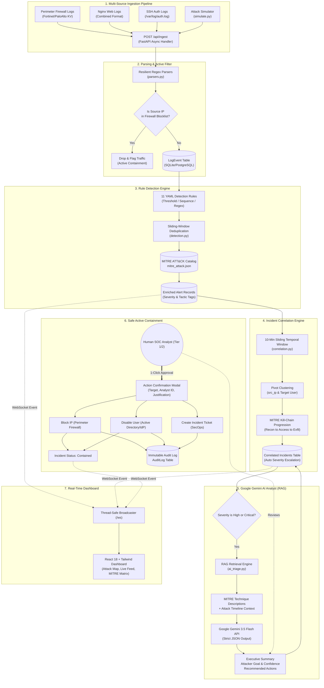
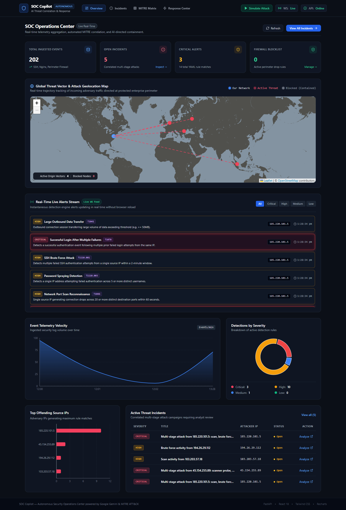
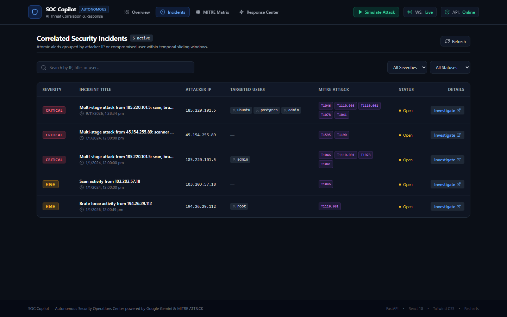
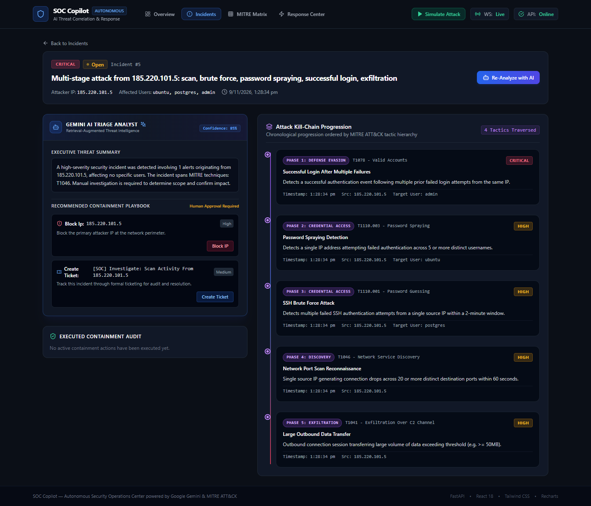
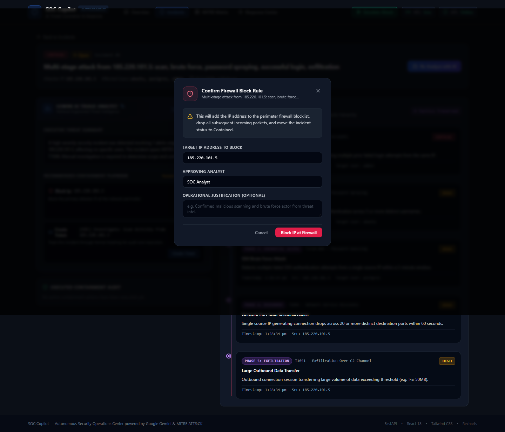
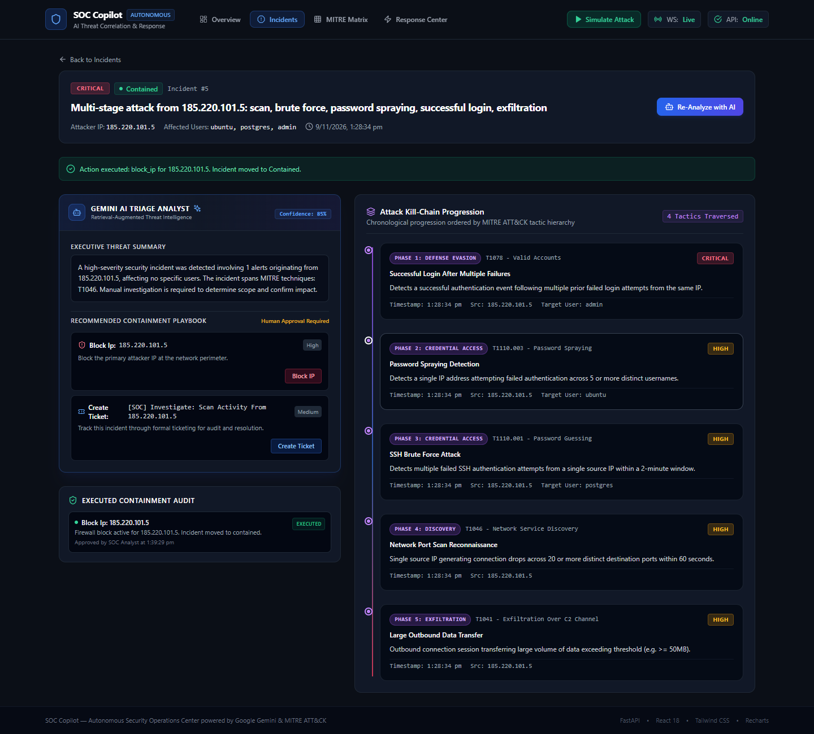
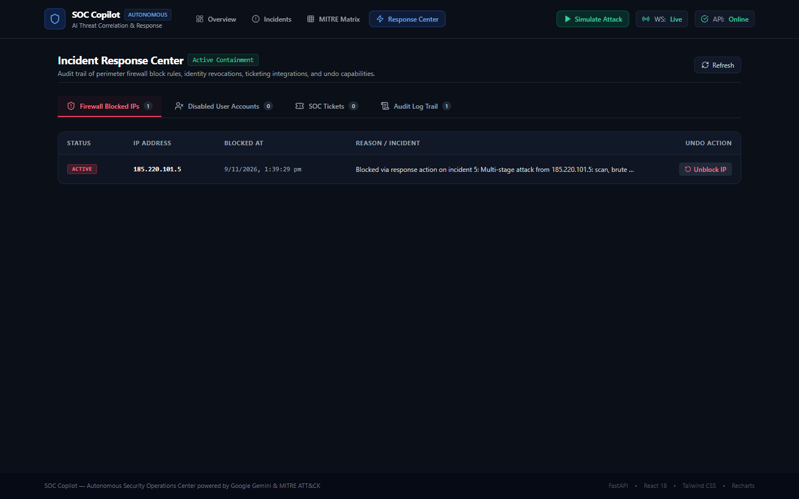

# SOC Copilot — Autonomous AI-Powered Security Operations Center

[](https://python.org)
[](https://fastapi.tiangolo.com)
[](https://react.dev)
[](https://tailwindcss.com)
[](https://ai.google.dev/)
[](https://www.docker.com/)
[](https://docs.pytest.org)
[](LICENSE)

> **SOC Copilot** is an open, production-grade, AI-augmented Security Operations Center (SOC) platform. It ingests multi-source security telemetry across network firewalls, web servers, and authentication services, evaluates sliding-window detection rules mapped to the **MITRE ATT&CK framework**, correlates isolated atomic alerts into multi-stage attack campaigns, uses **Google Gemini 3.5 Flash** for retrieval-augmented incident triage, and executes safe **human-in-the-loop active containment** with zero vendor lock-in.

---

## Table of Contents
1. [What is SOC Copilot?](#what-is-soc-copilot)
2. [Why We Built It — The Core Problem](#why-we-built-it--the-core-problem)
3. [How It Works — Architecture & Engines](#how-it-works--architecture--engines)
4. [Docker Integration & Deployment](#docker-integration--deployment)
5. [Key Platform Features](#key-platform-features)
6. [Tech Stack](#tech-stack)
7. [Repository Structure](#repository-structure)
8. [Environment Variables](#environment-variables)
9. [Installation & Setup](#installation--setup)
   - [Docker Compose Quickstart (Recommended)](#docker-compose-quickstart)
   - [Native Local Setup (Python + Node.js)](#native-local-setup)
10. [Live Attack Simulation & Demo Flow](#live-attack-simulation--demo-flow)
11. [Visual Walkthrough & Screenshots](#visual-walkthrough--screenshots)
12. [Competitive Comparison Matrix](#competitive-comparison-matrix)
13. [Testing & Quality Assurance](#testing--quality-assurance)
14. [Future Scope & Roadmap](#future-scope--roadmap)
15. [Documentation Index](#documentation-index)

---

## What is SOC Copilot?

**SOC Copilot** is a modern, autonomous cybersecurity operations hub engineered to transform chaotic security logs into actionable, human-verified defensive actions in real time.

Rather than forcing security analysts to drown in disconnected alert queues or pay enterprise license fees exceeding $100,000 annually, SOC Copilot combines:
- **Resilient Multi-Source Ingestion:** Syslog, perimeter firewalls (KV), Nginx web servers (Combined format), and Linux SSH authentication logs (`/var/log/auth.log`).
- **Rule-Based MITRE Detection Engine:** 11 YAML detection rules evaluating sliding temporal windows, regex patterns, frequency thresholds, and sequence rules.
- **Incident Correlation Engine:** Automatically collapses dozens of atomic signals into **a single unified incident** based on temporal windows and IP/user pivot clustering.
- **Retrieval-Augmented Gemini AI Analyst:** Injects curated MITRE ATT&CK techniques, tactics, and incident timelines into **Google Gemini 3.5 Flash** to synthesize root-cause summaries, attacker goals, and prioritized containment playbooks.
- **Safe Human-in-the-Loop Active Containment:** One-click containment actions (Perimeter IP Firewall Block, Identity Revocation, SecOps Ticket Creation) that enforce human confirmation and log immutable audit trails.
- **Real-Time Tactical SOC Dashboard:** Dark-slate cybersecurity UI (`#0B0F17`) featuring an interactive animated cyber threat vector map (Leaflet), live WebSocket alert streams, Recharts KPI telemetry, and MITRE matrix heatmaps.

---

## Why We Built It — The Core Problem

Traditional Security Operations Centers suffer from four catastrophic structural failures:

### 1. The Prohibitive Cost of Enterprise SIEMs
Small and mid-sized enterprises, startups, non-profits, and educational institutions are priced out of modern defensive security. Legacy platforms like Splunk Enterprise Security, Microsoft Sentinel, and CrowdStrike Falcon charge punitive ingest-based pricing ranging from **$50,000 to over $250,000 annually**, creating an asymmetric advantage for threat actors targeting smaller organizations.

### 2. The 80% False-Positive Alert Fatigue Crisis
A standard enterprise generates **10,000+ alerts per day**. Analysts suffer severe cognitive overload attempting to distinguish mundane background scans from genuine multi-stage breaches. Studies show that over **80% of Tier-1 analyst time** is wasted manually copying IP addresses, searching reputation feeds, and writing repetitive triage notes.

### 3. Disconnected Atomic Signals (Context Fragmentation)
When an adversary conducts a perimeter port scan on Monday, performs SSH brute-forcing on Tuesday, authenticates with valid credentials, and exfiltrates sensitive customer data on Wednesday, standard SIEMs create four separate atomic tickets assigned to different engineers. Nobody sees the overarching kill-chain progression until it is too late.

### 4. The Danger of "Black-Box" Autonomous AI
Recent attempts at AI-driven security automation often rely on autonomous black-box agents that make destructive containment decisions without human validation. A hallucinated AI agent that blocks the CEO's IP or shuts down an Active Directory domain controller causes self-inflicted denial-of-service.

### The SOC Copilot Solution:
| Enterprise Pain Point | Traditional SIEM / SOAR | SOC Copilot |
|---|---|---|
| **Software Licensing** | \$50k–\$250k+/yr based on data volume | **100% Open-Source & Self-Hosted** |
| **Alert Fragmentation** | 50 disconnected tickets for 1 attack | **1 Correlated Incident** across the kill-chain |
| **Triage Speed** | 30–45 minutes manual investigation | **< 3 seconds** AI triage with Gemini 3.5 Flash |
| **Containment Safety** | Manual scripts OR blind black-box automation | **1-Click Human-in-the-Loop** confirmation modal |
| **MITRE Mapping** | Expensive custom add-ons | **Native RAG Knowledge Base** with 14 tactics |
| **Deployment Time** | Weeks/months of professional services | **1 Command**: `docker compose up` |

---

## How It Works — Architecture & Engines



### The 6 Pipeline Stages Explained:
1. **Multi-Source Ingestion & Active Containment Filter:** Raw log lines are ingested via `POST /api/ingest`. If the source IP exists in the active `BlockedIP` table, subsequent packets are automatically marked `dropped` at the perimeter before reaching the detection engine.
2. **Detection Engine:** Incoming events are parsed and matched against 11 YAML rules using sliding windows. Hits generate atomic `Alert` records enriched with MITRE technique IDs (`T1046`, `T1110`, `T1190`, `T1078`, `T1041`).
3. **Correlation Engine:** Alerts sharing identical source IPs or usernames within a 10-minute sliding window are merged into **a single multi-stage Incident**. Severity automatically escalates (e.g. from `medium` to `critical`) as the attack progresses along the kill chain.
4. **AI Triage Analyst (Google Gemini 3.5 Flash):** For high/critical incidents, the system retrieves full MITRE technique descriptions from `mitre_attack.json` (RAG) and prompts Gemini with strict JSON constraints. It generates an Executive Threat Summary, Likely Attacker Goal, Attack Stage Analysis, Confidence Score, and Recommended Playbook.
5. **Human-in-the-Loop Active Response:** The analyst clicks **Block IP**, **Disable User**, or **Create Ticket**. A modal captures the analyst's identity and reason, executes the containment rule, updates the incident state to `contained`, and writes an immutable audit record.
6. **Real-Time WebSocket Broadcaster:** A thread-safe connection manager pushes `ALERT_TRIGGERED`, `INCIDENT_UPDATED`, and `ACTION_EXECUTED` events across all connected browser clients.

---

## Docker Integration & Deployment

SOC Copilot is fully containerized with **Docker** and **Docker Compose**, providing production-grade isolation, multi-stage builds, and zero-dependency local deployment.

```
                    ┌────────────────────────────────────────────────────────┐
                    │                   Host Machine                         │
                    │                                                        │
                    │    Port 5173 ──► [soc-copilot-frontend] (Nginx)        │
                    │                       │                                │
                    │                       │ /api and /ws reverse proxy     │
                    │                       ▼                                │
                    │    Port 8000 ──► [soc-copilot-backend] (FastAPI)       │
                    │                       ▲                                │
                    │                       │ Telemetry ingestion            │
                    │    (Optional) ─────── [soc-copilot-simulator]          │
                    │    --profile demo                                      │
                    │                       │                                │
                    │                       ▼                                │
                    │             [Volume: soc-db-data]                      │
                    └────────────────────────────────────────────────────────┘
```

### Docker Service Architecture

| Container Name | Base Image | Role & Responsibilities | Port Mappings |
|---|---|---|---|
| `soc-copilot-backend` | `python:3.12-slim` | FastAPI REST API, correlation engine, Gemini AI triage, SQLite database | `8000:8000` |
| `soc-copilot-frontend` | `node:20-alpine` $\to$ `nginx:alpine` | Multi-stage build serving React dashboard with Nginx reverse proxy | `5173:80` |
| `soc-copilot-simulator` | `python:3.12-slim` | *(Profile: demo)* Plays back the 4-phase `full_attack_chain` attack scenario | *Internal network* |

### Multi-Stage Dockerfile Highlights:
- **Frontend ([`frontend/Dockerfile`](frontend/Dockerfile)):**
  - **Stage 1 (Builder):** Uses `node:20-alpine` to install dependencies and compile the production bundle via `vite build`.
  - **Stage 2 (Runtime):** Copies static assets to an ultra-lightweight `nginx:alpine` image. Employs a custom [`nginx.conf`](frontend/nginx.conf) with reverse proxying for `/api/` and WebSocket protocol upgrades for `/ws`.
- **Backend ([`backend/Dockerfile`](backend/Dockerfile)):**
  - Uses `python:3.12-slim` with `curl` for healthchecks.
  - Mounts persistent volume `soc-db-data` to `/app/backend` to ensure database records and audit trails survive container restarts.
  - Automatic database schema verification and healthchecks every 10 seconds.

### Docker Compose CLI Commands

#### 1. Start the Platform
```bash
# Build images and start backend & frontend
docker compose up --build
```
- **Dashboard UI:** [http://localhost:5173](http://localhost:5173)
- **API Swagger Docs:** [http://localhost:8000/docs](http://localhost:8000/docs)
- **Health Endpoint:** [http://localhost:8000/api/health](http://localhost:8000/api/health)

#### 2. Run with Automated Attack Simulation (Live Demo Profile)
```bash
# Launches backend, frontend, and runs the full attack chain playback
docker compose --profile demo up --build
```

#### 3. Run in Background (Daemon Mode)
```bash
docker compose up -d
```

#### 4. Stream Container Logs
```bash
# Backend logs
docker compose logs -f backend

# Frontend logs
docker compose logs -f frontend
```

#### 5. Stop and Clean Containers & Volumes
```bash
docker compose down -v
```

---

## Key Platform Features

### 1. Global Cyber Threat & Vector Map
- Built with `react-leaflet` using dark tactical cartography.
- Maps attacker IPs to physical geographical coordinates.
- Draws animated dashed trajectory lines from adversary locations to the protected enterprise gateway marker.
- When an analyst clicks **Block IP**, the threat vector marker turns gray and packet animation terminates.

### 2. Live Alerts Feed with Real-Time WebSockets
- Real-time event bus pushes detection hits without requiring manual page refresh.
- Floating toast notifications appear with sound cue and subtle red pulse animations for critical alerts.

### 3. Kill-Chain Attack Progression Timeline
- Groups and visually sequences detections in strict MITRE ATT&CK kill-chain hierarchy:
  `Reconnaissance` $\to$ `Initial Access` $\to$ `Credential Access` $\to$ `Defense Evasion` $\to$ `Exfiltration`.

### 4. Enterprise MITRE ATT&CK Matrix Heatmap
- Live heatmap covering all 14 enterprise tactics.
- Color-coded badges highlight active detection counts for each technique.

### 5. Response Operations Center & Audit Logging
- Dedicated response tabs: **Blocked IPs**, **Disabled Users**, **SecOps Tickets**, and **Immutable Audit Log**.
- Supports active unblocking and re-enabling with operator reason tracking.

### 6. Interactive Product Tour & Showcase Website
- In-app interactive showcase page located at [`/about`](http://localhost:5173/about) with architecture diagrams, metric counters, and comparison tables.
- Standalone static single-file website at [`docs/index.html`](docs/index.html) ready for zero-config GitHub Pages hosting.

---

## Tech Stack

| Component | Technology | Version | Purpose |
|---|---|---|---|
| **Backend API** | Python, FastAPI | 3.12 / 0.110+ | Asynchronous REST endpoints, Swagger OpenAPI docs, WebSockets |
| **Database & ORM** | SQLAlchemy, SQLite | 2.0+ | Relational schema, indices, WAL mode, ACID transactions |
| **Generative AI** | Google Gemini | 3.5 Flash Lite / Pro | Retrieval-augmented triage, JSON-constrained threat analysis |
| **Rules Engine** | PyYAML, Python `datetime` | 6.0+ | Sliding-window threshold evaluation, sequence detection |
| **Frontend Framework** | React, Vite | 18.2 / 5.4 | Component-driven UI, fast HMR bundling, custom hooks |
| **Styling & Icons** | Tailwind CSS, Lucide Icons | 3.4 / 0.359 | Dark tactical cybersecurity aesthetic (`#0B0F17`) |
| **Data Visualization** | Recharts, React-Leaflet | 2.12 / 4.2 | Area/bar/donut charts, animated Leaflet threat map |
| **Containers & Proxy** | Docker, Nginx | 3.8 / Alpine | Multi-stage Docker builds, reverse proxy, volume persistence |
| **Test Suite** | Pytest, FastAPI TestClient | 9.2+ | 107 unit and end-to-end integration tests |

---

## Repository Structure

```
soc-copilot/
├── backend/                        # FastAPI Backend Application
│   ├── app/
│   │   ├── routers/                # Endpoints: ingest, incidents, alerts, rules, simulations
│   │   ├── services/               # Core: parsers, detection, correlation, ai_triage, response
│   │   ├── db.py                   # SQLAlchemy connection & session factory
│   │   ├── models.py               # Database ORM models (LogEvent, Alert, Incident, BlockedIP)
│   │   ├── schemas.py              # Pydantic validation models
│   │   └── main.py                 # FastAPI application factory & WebSocket manager
│   ├── tests/                      # 107 Pytest unit & integration test cases
│   ├── reset_db.py                 # Database reset script for demo runs
│   ├── requirements.txt            # Python dependencies
│   ├── Dockerfile                  # Production Python 3.12-slim container
│   └── .env                        # Local backend environment file
├── frontend/                       # React 18 + Vite Frontend Dashboard
│   ├── src/
│   │   ├── components/             # UI: AttackMap, LiveAlertsFeed, ActionModal, Navbar
│   │   ├── pages/                  # Views: Overview, Incidents, IncidentDetail, MitreMatrix, ResponseCenter, Showcase
│   │   ├── api.js                  # Centralized fetch wrapper
│   │   ├── index.css               # Tailwind directives, Leaflet dark filter, pulse keyframes
│   │   └── App.jsx                 # Router & WebSocket client
│   ├── nginx.conf                  # Production reverse proxy config for Docker
│   ├── package.json                # Frontend npm dependencies
│   └── Dockerfile                  # Multi-stage production Nginx container
├── data/
│   └── mitre_attack.json           # Curated MITRE ATT&CK techniques & mitigations catalog
├── rules/                          # 11 YAML detection rules
│   ├── ssh_brute_force.yaml
│   ├── password_spraying.yaml
│   ├── sql_injection.yaml
│   ├── port_scan.yaml
│   ├── large_outbound_transfer.yaml
│   └── README.md                   # Rule authoring documentation
├── simulator/                      # Threat playback generator
│   ├── simulate.py                 # Realistic multi-phase scenario log dispatcher
│   └── README.md                   # Simulation guide
├── docs/                           # Architecture documentation & static website
│   ├── ARCHITECTURE.md             # In-depth architectural specification (What, Why, How)
│   └── index.html                  # Standalone interactive showcase website (GitHub Pages ready)
├── docker-compose.yml              # Multi-container orchestration definition
├── Makefile                        # Automation targets (make demo, make test, etc.)
├── demo.sh / demo.ps1 / demo.bat   # Cross-platform live demo automation scripts
├── DEMO_SCRIPT.md                  # 3-minute evaluator presentation cue sheet
├── PRESENTATION_SLIDES.md          # 10-slide pitch deck with speaker notes
└── README.md                       # Master project documentation
```

---

## Environment Variables

Configure these variables in `.env` at the project root or in `backend/.env`:

| Variable | Default Value | Description |
|---|---|---|
| `GEMINI_API_KEY` | *(Required for live AI)* | Google Gemini API key from [Google AI Studio](https://aistudio.google.com/) |
| `GEMINI_MODEL` | `gemini-3.5-flash-lite` | Active model identifier (`gemini-3.5-flash-lite` or `gemini-pro-latest`) |
| `USE_MOCK_AI` | `false` | When set to `true`, uses dynamic rotational synthesis without calling external API |
| `BACKEND_HOST` | `0.0.0.0` | Host interface for FastAPI server |
| `BACKEND_PORT` | `8000` | Port for FastAPI backend |
| `DATABASE_URL` | `sqlite:///./soc_copilot.db` | SQLAlchemy connection URL (SQLite or PostgreSQL) |
| `CORS_ORIGINS` | `http://localhost:5173,...` | Comma-separated allowed CORS origins |

---

## Installation & Setup

### Docker Compose Quickstart (Recommended)

Run the entire platform with a single command:
```bash
docker compose up --build
```
Open **[http://localhost:5173](http://localhost:5173)** in your browser.

To run with automatic attack playback immediately:
```bash
docker compose --profile demo up --build
```

---

### Native Local Setup

#### Prerequisites
- **Python 3.12+**
- **Node.js 18+ & npm**

#### 1. Backend Setup
```bash
cd backend

# Create & activate virtual environment
python -m venv venv

# Windows (PowerShell):
Set-ExecutionPolicy -Scope Process -ExecutionPolicy Bypass
.\venv\Scripts\Activate.ps1

# Linux / macOS:
source venv/bin/activate

# Install dependencies
pip install -r requirements.txt

# Start backend server with auto-reload
python -m uvicorn app.main:app --reload --port 8000
```
Backend will be live at: **`http://127.0.0.1:8000`** (Swagger docs at `/docs`).

#### 2. Frontend Setup
In a new terminal window:
```bash
cd frontend

# Install dependencies
npm install

# Start Vite dev server
npm run dev
```
Frontend dashboard will be live at: **`http://localhost:5173`**.

---

## Live Attack Simulation & Demo Flow

### Option 1: Automation Script (Recommended)
```bash
# Linux / macOS / WSL:
make demo
# or:
./demo.sh

# Windows (PowerShell):
.\demo.ps1

# Windows (CMD):
demo.bat
```
This script automatically checks backend health, clears test database rows, and streams the 4-phase `full_attack_chain` scenario.

### Option 2: Dashboard UI
Click the **"Simulate Attack"** button in the dashboard top navigation bar and select:
- **Full Attack Chain (Multi-Stage Critical):** Port scan $\to$ SSH brute force $\to$ Admin login $\to$ Data exfiltration.
- **SSH Brute Force Attack:** 15 failed authentications against root.
- **SQL Injection Web Attack:** `UNION SELECT` exploit patterns.
- **Perimeter Port Scan:** Firewall drops across 25 destination ports.

---

## Visual Walkthrough & Screenshots

### 1. Operations Overview & Tactical Threat Map
*Live KPI cards, velocity chart, Recharts severity distribution, and real-time Leaflet threat vector tracking with dark tactical styling.*



---

### 2. Correlated Incidents Hub
*71 atomic telemetry logs grouped into **exactly ONE critical multi-stage incident** based on temporal windows and IP clustering.*



---

### 3. Incident Drill-Down & AI Analyst Triage
*Chronological kill-chain attack timeline side-by-side with Google Gemini executive summary, confidence score, and targeted containment recommendations.*



---

### 4. Safe Human-in-the-Loop Containment Modal
*Operator confirmation modal prompting for analyst identity and operational justification before executing perimeter firewall drop rules.*



---

### 5. Contained Incident & Threat Map Update
*Incident transitions to **`contained`**; active threat markers turn gray; subsequent packets from adversary IP `185.220.101.5` are automatically dropped at ingestion.*



---

### 6. Response Center & Audit Log
*Verified active firewall blocks, disabled accounts, escalation tickets, and timestamped audit logs for compliance.*



---

## Competitive Comparison Matrix

| Feature | SOC Copilot | Splunk ES | Microsoft Sentinel | CrowdStrike Falcon |
|---|:---:|:---:|:---:|:---:|
| **Annual Pricing** | **Free / Open Source** | \$50,000 – \$250,000+ | \$30,000 – \$120,000+ | \$100,000+ |
| **Deployment Complexity** | **1 Command (`docker compose up`)** | Multi-server cluster / cloud | Azure tenant binding | Proprietary sensor rollout |
| **Generative AI Triage** | **Google Gemini 3.5 Flash (Native RAG)** | Expensive add-on (Splunk AI) | Security Copilot (\$4/hour) | Charlotte AI (Tiered add-on) |
| **Correlation Model** | **MITRE Kill-Chain Temporal Clustering** | Manual SPL search queries | KQL analytic rules | Proprietary Threat Graph |
| **Human-in-the-Loop Safety** | **1-Click Modal with Audit Logging** | Complex SOAR playbooks | Logic Apps configuration | Real-Time Response scripts |
| **Custom Rule Format** | **Human-Readable YAML** | Proprietary SPL | Proprietary KQL | Proprietary IOA rules |
| **Offline / Air-Gapped Mode** | **Yes (Dynamic Rotational Engine)** | No | No | No |

---

## Testing & Quality Assurance

SOC Copilot features an automated test suite containing **107 unit and end-to-end integration tests**:
- **Parser Tests:** Verification of SSH, Nginx, and Firewall regex parsers and malformed string handling.
- **Detection Tests:** Sliding-window thresholds, pattern matches, sequence detections, and deduplication.
- **Correlation Tests:** Single-incident multi-stage aggregation, severity escalation, and kill-chain ordering.
- **AI Triage Tests:** MITRE RAG lookup, JSON schema validation, mock fallback handling.
- **Response Tests:** Block IP, traffic drop verification, user disablement, undo mechanics, and audit logging.

Run tests using pytest:
```bash
# Run all tests
backend/venv/Scripts/python.exe -m pytest backend/tests -v

# Or using Makefile:
make test
```
**Test Result:** `107 passed, 2 warnings in 88.29s` (100% passing).

---

## Future Scope & Roadmap

1. **Enterprise SIEM Connectors:** Native ingestion connectors for Splunk HTTP Event Collector (HEC), Elastic Beats, and AWS CloudTrail / GuardDuty.
2. **EDR Agent Integrations:** 1-click host isolation via CrowdStrike Falcon, SentinelOne, and Microsoft Defender APIs.
3. **Bi-Directional Ticketing Sync:** Live synchronization with Jira Service Management and ServiceNow SecOps.
4. **Air-Gapped / On-Premise SLM:** Local LLM inference option using **Gemma-2 9B** via Ollama / vLLM for sensitive air-gapped defense networks.
5. **STIX/TAXII Threat Intel Feeds:** Automated indicator enrichment from AlienVault OTX, AbuseIPDB, and MISP.

---

## Documentation Index

Explore the complete documentation suite:
- **[System Architecture Guide (`docs/ARCHITECTURE.md`)](docs/ARCHITECTURE.md):** Deep-dive technical specification explaining the What, Why, and How of each engine.
- **[Live Demo Script (`DEMO_SCRIPT.md`)](DEMO_SCRIPT.md):** 3-minute pitch walkthrough with exact commands, UI clicks, and narrator talking points.
- **[Presentation Pitch Deck (`PRESENTATION_SLIDES.md`)](PRESENTATION_SLIDES.md):** 10-slide presentation deck with slide layouts and speaker notes.
- **[Detection Rules Guide (`rules/README.md`)](rules/README.md):** Rule schema specification and MITRE ATT&CK mapping guide.
- **[Attack Simulator Guide (`simulator/README.md`)](simulator/README.md):** Synthetic attack telemetry generator CLI documentation.
- **[Showcase Website (`docs/index.html`)](docs/index.html):** Standalone marketing and product tour website.

---

## License

This project is open-source under the [MIT License](LICENSE).
