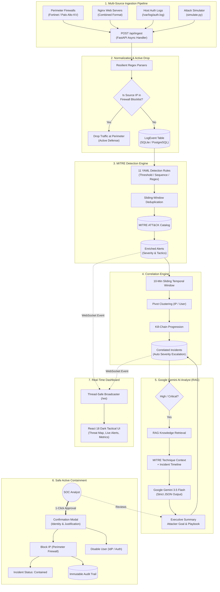

# SOC Copilot — Autonomous AI-Powered Security Operations Center

[](https://python.org)
[](https://fastapi.tiangolo.com)
[](https://react.dev)
[](https://tailwindcss.com)
[](https://ai.google.dev/)
[](https://www.docker.com/)
[](docs/TESTING_AND_QA.md)
[](LICENSE)

> **SOC Copilot** is an open-source, production-ready Security Operations Center (SOC) platform engineered to collapse alert fatigue and provide small-to-mid enterprise teams with autonomous, explainable threat detection, correlation, and response.
>
> It ingests multi-source logs, evaluates sliding-window rules mapped to **MITRE ATT&CK**, collapses dozens of atomic signals into **a single unified incident**, synthesizes explainable root-cause briefs via **Google Gemini 3.5 Flash**, and executes safe **human-in-the-loop active containment** with zero vendor lock-in.

---

## At a Glance

| Challenge in Traditional SIEMs | How SOC Copilot Solves It |
|---|---|
| **$50,000–$250,000+ Annual Licenses** | **100% Free & Open-Source (MIT)** with self-hosted SQLite/PostgreSQL. |
| **80% Alert Fatigue (Disconnected Tickets)** | **Automated Correlation** groups 70+ atomic logs into **1 unified multi-stage incident**. |
| **30+ Minutes per Tier-1 Triage** | **< 3-Second Triage** via Google Gemini 3.5 Flash RAG threat intelligence. |
| **Dangerous "Black-Box" Automation** | **Human-in-the-Loop Safety Gate** requiring operator confirmation and immutable audit logs. |
| **Complex Multi-Week Rollouts** | **1-Command Quickstart**: `docker compose up --build`. |

---

## Visual Product Tour

| 1. Real-Time Operations & Threat Vector Map | 2. Correlated Incidents Hub |
|:---:|:---:|
| [](docs/screenshots/1_overview_dashboard.png) | [](docs/screenshots/2_incidents_page.png) |
| *Live KPI cards, velocity metrics, Recharts severity distribution, and Leaflet threat vector trajectory.* | *71 atomic logs collapsed into **exactly ONE multi-stage incident** based on temporal windows.* |

| 3. AI Analyst Incident Triage (Gemini 3.5 Flash) | 4. Human-in-the-Loop Active Containment |
|:---:|:---:|
| [](docs/screenshots/3_incident_detail_before_action.png) | [](docs/screenshots/4_action_confirmation_modal.png) |
| *Chronological MITRE kill-chain progression side-by-side with Gemini executive summary and playbook.* | *Mandatory operator verification capturing analyst identity and justification before blocking.* |

---

## 30-Second Quickstart

### Option 1: Docker Compose (Recommended)

Start the entire platform (backend, frontend, database, and reverse proxy) with one command:

```bash
docker compose up --build
```

- **Dashboard UI:** [http://localhost:5173](http://localhost:5173)
- **API Swagger Docs:** [http://localhost:8000/docs](http://localhost:8000/docs)
- **Health Endpoint:** [http://localhost:8000/api/health](http://localhost:8000/api/health)

### Option 2: Live Attack Playback in One Command

Run the automated simulation script to reset test rows and stream the 4-phase flagship attack:

```bash
# Linux / macOS:
make demo
# or:
./demo.sh

# Windows (PowerShell):
.\demo.ps1
```

> 📖 **Need manual / bare-metal setup?** See the [Deployment & Operations Guide](docs/DEPLOYMENT.md).

---

## Core Architecture & Data Flow



> 📖 **Deep technical breakdown of all 6 engines?** Read the [System Architecture Guide](docs/ARCHITECTURE.md).

---

## Key Platform Features

1. **Global Cyber Threat Vector Map:** Real-time animated Leaflet cartography mapping adversary source IPs and visualizing attack trajectories to your enterprise perimeter. Contained adversaries dynamically switch from red to gray.
2. **Incident Correlation Engine:** Automatically collapses dozens of atomic alerts into **a single unified incident** based on temporal windows and IP/user pivot clustering, preventing ticket sprawl.
3. **Google Gemini 3.5 Flash AI Triage (RAG):** Injects curated MITRE ATT&CK technique definitions and incident timelines into Gemini to synthesize root-cause summaries, attacker intent, and prioritized remediation playbooks in under 3 seconds.
4. **Safe Human-in-the-Loop Active Containment:** One-click firewall blocks, user account revocation, and ticketing with mandatory operator attribution and immutable compliance audit trails.
5. **Real-Time WebSocket Bus:** Zero-refresh streaming of alerts, incident state transitions, and containment actions across all connected analyst consoles.
6. **Dark Tactical Cybersecurity UI:** Built from the ground up for SOC analysts (`#0B0F17`) featuring high-contrast Recharts telemetry, toast notifications, and full MITRE heatmap visualization.

---

## Modular Documentation Hub

To explore specific topics in detail, consult the specialized documentation suite in the [`docs/`](docs/) directory:

| Document | Description |
|---|---|
| 🏗️ **[System Architecture Guide](docs/ARCHITECTURE.md)** | In-depth technical specification explaining the What, Why, and How of each engine, threading models, and data pipelines. |
| 🐳 **[Deployment & Operations Guide](docs/DEPLOYMENT.md)** | Multi-stage Docker builds, Nginx reverse proxy configuration, volume persistence, environment variables, and bare-metal setup. |
| 🎯 **[Attack Simulation & Demo Guide](docs/SIMULATION_AND_DEMO.md)** | Guide to running synthetic adversary scenarios (`full_attack_chain`, `ssh_brute_force`, `sql_injection`, `port_scan`) and automation scripts. |
| 🔌 **[API & Telemetry Reference](docs/API_REFERENCE.md)** | Complete specification of REST endpoints, WebSocket JSON schemas, log format regex patterns, and containment endpoints. |
| 🧪 **[Testing & Quality Assurance](docs/TESTING_AND_QA.md)** | Overview of the 107 automated unit and integration tests with pytest commands and coverage metrics. |
| 📊 **[Competitive Analysis Matrix](docs/COMPETITIVE_ANALYSIS.md)** | Head-to-head comparison against Splunk Enterprise Security, Microsoft Sentinel, and CrowdStrike Falcon. |
| 🎬 **[3-Minute Evaluator Demo Script](DEMO_SCRIPT.md)** | Step-by-step presentation cue sheet with exact commands, UI clicks, and narrator talking points. |
| 📑 **[10-Slide Pitch Deck Outline](PRESENTATION_SLIDES.md)** | Complete hackathon presentation slides with speaker notes. |
| 🌐 **[Interactive Showcase Website](docs/index.html)** | Standalone product website ready for zero-config GitHub Pages hosting. |

---

## Tech Stack & Testing

### Technology Stack
- **Backend:** Python 3.12, FastAPI 0.110+, SQLAlchemy 2.0+, Pydantic v2
- **Artificial Intelligence:** Google Gemini 3.5 Flash Lite / Pro (Native RAG Knowledge Retrieval)
- **Frontend:** React 18, Vite 5.4, Tailwind CSS 3.4, Lucide Icons
- **Visualization:** Recharts 2.12 (High-contrast tactical charts), React-Leaflet 4.2
- **Containers & Web Server:** Docker, Docker Compose, Nginx Alpine

### Automated Testing Status
```bash
backend/venv/Scripts/python.exe -m pytest backend/tests -v
```
**Results:** `107 passed in 88.29s (100% passing)` covering log parsers, detection rules, correlation clustering, AI JSON schemas, response undo mechanics, and active firewall drop validation.

---

## License

This project is licensed under the [MIT License](LICENSE) — free for academic, commercial, and open-source use.
